<!-- readme-standard: 2026-11-02 -->

# 🧾 Tax Assistant

*AI-assisted tax position management — back-tax relief navigation, transaction-history reconstruction, filing support*

   

 **You are here:** drasticstatic lab › `tax-assistant` · private source · `main` is the working branch · public twin `tax-assistant-public-preview`

##  TL;DR

1.  **What this is.** A private workspace for AI-assisted tax work. The public twin carries structure and method only, never account detail.
2.  **Who it is for.** Christopher now; a public-safe write-up of the method is planned for others.
3.  **Do this first.** [Explore the public preview](https://drasticstatic.github.io/tax-assistant-public-preview/).
4.  **The reading room.** [`business/`](business/README.md): the expense ledger, the IRS notes and their PDFs, public on purpose.

**🌐 [Explore the Public Preview →](https://drasticstatic.github.io/tax-assistant-public-preview/)**

---

> 🔒 Public mirror notice: This repository is partially mirrored as a public preview of the private source via an automated sync pipeline, matching the pattern used by [`a sibling repository`](https://drasticstatic.github.io/divorce-custody-assistant-public-preview/). The public mirror stays minimal until content is explicitly reviewed and allowlisted for export — see the Public preview boundary section below.

## What this project is for

This repo tracks Christopher's federal (and applicable state) tax position: back-tax debt originating from early retirement-account liquidations used as survival capital during a period of hardship, ongoing navigation of IRS relief programs (currently **Currently Not Collectible / CNC** status), and the historical reconstruction of stock and cryptocurrency transaction history needed to file accurate returns and pursue further relief.

It grew out of work that started inside `trading-assistant` — understanding the tax implications of stock and crypto positions — and was split into its own repo so tax-specific work (relief-program research, filing prep, transaction-history reconstruction) has its own space, separate from trading-strategy work, while still staying closely linked to it.

Planned/ongoing capabilities:

- transaction-history reconstruction across exchanges, DeFi protocols, and prop-firm accounts (via CoinLedger and manual review)
- IRS relief-program tracking and strategy (CNC → Offer in Compromise, penalty abatement, installment agreements)
- filing support — Form 433-A preparation, back-tax return reconciliation
- a public-safe methodology writeup, eventually, for anyone navigating a similar situation (early-withdrawal tax debt from financial hardship, crypto/DeFi transaction reconstruction) — no account-level detail, ever

## Current status

**Early / in-progress** — repo scaffolding just established (2026-08-21); real content follows as reconstruction and relief-program work continues.

## Public preview boundary

Same allowlist model as `a sibling repository`: private-by-default, new root paths must be explicitly classified before they can export.

- `holdings/`, `correspondence/`, and `filings/` are never public — they hold account-linked position data, IRS/state correspondence, and draft/filed return material.
- The public mirror (`tax-assistant-public-preview`), once anything is published there, will hold structure and methodology only — never account numbers, SSN/EIN, specific dollar figures tied to a live matter, or anything that could assist someone else in impersonating Christopher to a tax authority.

## Agent roles

Built and maintained with **Anthropic's Claude** (Claude Code CLI).

**Fortuna** leads this work — she started it inside `trading-assistant` to understand the tax implications of stock and crypto positions, and continues leading relief-program strategy and transaction-history reconstruction here.

**Alfred** handles repo scaffolding, sync-pipeline setup, and cross-repo coordination.

## A note on approach

This repo's operating posture is full legal compliance pursued through legitimate IRS relief channels — CNC, Offer in Compromise, penalty abatement, installment agreements — not tax-protester or "sovereign citizen" theory. That material gets flagged and set aside wherever it surfaces, not incorporated into strategy. The goal is genuine resolution, approached honestly.

---

*Companion repos in this ecosystem: [Divorce & Custody Assistant](https://drasticstatic.github.io/divorce-custody-assistant-public-preview/) · [Trading Assistant](https://drasticstatic.github.io/trading-assistant-public-preview/) (see its live [Tax Tracker](https://drasticstatic.github.io/trading-assistant-public-preview/data/tax/tax.html))*

##  Suggest a change

Noticed something? Open an [issue](../../issues) or a pull request against `main`; Christopher reads them and a person with the role merges. Not on GitHub? Reach Christopher through [his contact page](https://drasticstatic.github.io/resume/pages/contact.html).

The front door follows the living [README standard](https://github.com/drasticstatic/my-template/blob/main/README-STANDARD.md). Copy it, improve it.
