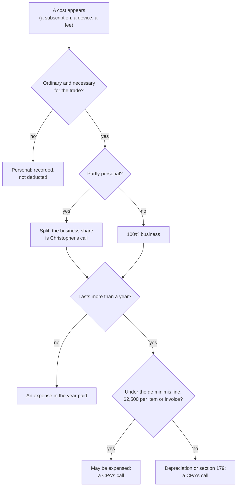

# IRS notes: the homework, shown

*Every IRS fact the business pages lean on, quoted where the IRS's own words carry the weight, each with its page and the day it was read. A reading room, not a return.*

##  TL;DR

1. **What this page is.** The IRS pages read on 2026-11-04 while the [expense ledger](EXPENSE-LEDGER.md) was started, set down fact by fact so nobody has to take the ledger's word for the rules it follows. Quotation marks mean the IRS's words; everything else is a plain-language reading of them.
2. **What it is not.** Tax advice, a filing, or a position. A CPA decides what a return says; this page only shows that the homework was done and where it came from.
3. **What we intend.** Keep the ledger honest, resolve the existing balance with the IRS in good standing, and file as an example worth showing rather than a case to be punished. The private lanes of this repository hold the position itself; nothing here names an amount, an account or a notice.

##  Publication 334 (2025), Tax Guide for Small Business

Page: <https://www.irs.gov/publications/p334> · read 2026-11-04.

| Topic | What the IRS says | Why the ledger cares |
|---|---|---|
| The test for a deductible expense | A business expense must be "ordinary and necessary". Ordinary means "common and accepted in your field"; necessary means "helpful and appropriate", and the publication says an expense need not be indispensable to be necessary. | Each ledger row has a "What it does for the work" column so the ordinary-and-necessary case is written down the day the tool is bought, not reconstructed later. |
| Mixed-use costs | An expense that is partly personal must be separated, and the personal part is not deductible. | The "Business share" column: 100%, mixed, personal, or **?** until decided. |
| Things that last | Property "expected to last more than a year" is generally not deducted whole in the year bought. | The hardware table is kept apart from software and services for this reason. |
| Section 179 | The section 179 maximum for 2025 is "generally $2,500,000". | Far above anything in the ledger; recorded so the ceiling is known. |
| De minimis safe harbor | "up to $2,500 per item or invoice" without an applicable financial statement; $5,000 with one. | Most of the hardware rows fall under this line, which is why a CPA may expense rather than depreciate them. The ledger says "a CPA's call" on every one. |
| Home office, simplified method | "$5 by the area" used "regularly and exclusively", "limited to 300 square feet". | The ledger's home-office section keeps the facts ready; nothing is claimed by the page. |
| Self-employment tax | Self-employment tax and Schedule SE apply from $400 of net earnings. | Why the business pages exist before there is an entity: the threshold is low. |
| One Schedule C per business | A separate Schedule C is filed for each business. | The desks (trading, Web3, the fleet's tech work for the organisations it serves) may be one trade or several; a CPA draws the line. |
| What a trade or business is | "an activity carried on to make a profit". | The ledger's reason for being: the activity is real, so its record should be too. |
| Software for filing taxes | Deductible if not depreciated or expensed under section 179, and its use "must not exceed 1 year". | A tax-software row will be added the year one is bought. |
| Business calls on a trip | Business calls made on a trip are deductible. | Noted for completeness; the ledger has no travel rows yet. Publication 463 covers travel. |

##  Get an Employer Identification Number

Page: <https://www.irs.gov/businesses/small-businesses-self-employed/get-an-employer-identification-number> · read 2026-11-04.

- An EIN is free, and the online application is completed in one session.
- One EIN per responsible party per day.
- The application needs the responsible party's SSN or ITIN.
- "Beware of websites that charge for an EIN."
- An LLC or corporation is registered with the state first; the EIN follows the entity.

*Why it matters here:* the day the business takes a name of its own, the EIN costs nothing and takes a session. Nothing is applied for by this page; see the legal lane below.

##  Start-up costs

Page: IRS Tax Tip 2021-166, <https://www.irs.gov/newsroom/heres-how-businesses-can-deduct-startup-costs-from-their-federal-taxes> · read 2026-11-04 · the page is marked historical by the IRS.

- Start-up costs are the costs to create or investigate a business, and they are deductible if the business could deduct them once it was running.
- The remainder is recovered over a 180-month period from the month the business opens.
- Costs to buy a specific existing business are capital, not start-up costs.

*Why it matters here:* the ledger's early rows (coursework, the first subscriptions, the first proposals) are the kind of cost this tip describes. Because the page is historical, a CPA checks the current rule before anything is claimed.

##  Home Office Deduction

Page: <https://www.irs.gov/businesses/small-businesses-self-employed/home-office-deduction> · last updated 2024-09-11 · marked historical · read 2026-11-04.

- The space must be used regularly and exclusively for the business, and be the principal place of business.
- Two methods: the simplified option under Rev. Proc. 2013-13, or the regular method on Form 8829.
- Publication 587 is the long form of the rule.

*Why it matters here:* the workstation's corner would have to be measured and kept to the work alone. The ledger records the facts and claims nothing.

##  Guide to business expense resources

Page: <https://www.irs.gov/businesses/small-businesses-self-employed/deducting-business-expenses> · read 2026-11-04.

- Publication 535 was discontinued after 2022.
- Publications 334 (small business), 587 (business use of your home) and 463 (travel, gift and car expenses) replace it.

*Why it matters here:* any older note that cites Publication 535 is pointing at a page the IRS no longer keeps; the three above are the current doors.

##  How a ledger row is read against these pages

*In words: every cost is written down; the IRS's two tests (ordinary and necessary, then the personal split) decide whether it is a business cost; the one-year and $2,500 lines decide how a CPA treats a thing that lasts. The ledger does the writing down. A CPA does the deciding.*

##  What we intend

Keep the ledger honest: every tool, seat and machine the work runs on, with its price and its business share, added the day it is bought and never erased. Resolve the existing balance with the IRS in good standing, through the relief channels the IRS itself offers, and keep this repository's private lanes as the record of that work. File as an example worth showing rather than a case to be punished: the public twin carries the method and these notes so that anyone in the same place can see what a sincere record looks like, and so the IRS, if it ever asks, can see the homework. No amounts, no account details and no notices appear on these public pages; the private lanes hold the position.

##  Related

- [EXPENSE-LEDGER.md](EXPENSE-LEDGER.md): the rows these rules are applied to.
- [001-github-pro.md](001-github-pro.md): the first proposal written against the ledger.
- **Legal**: the private repository [`drasticstatic/legal`](https://github.com/drasticstatic/legal) holds the entity, filings and counsel folders; questions for a CPA are drafted here and land in its `counsel/` folder.
- GitHub pricing, read 2026-11-04 at <https://github.com/pricing>: Free $0; Team $4 per user per month; Enterprise $21 per user per month. GitHub Pro for an individual account is named by GitHub's own upgrade prompt on private-repository rulesets ("Upgrade to GitHub Pro"), $4 a month; verify on the billing page.

*Not tax advice. Quotations are the IRS's; the readings are ours; the decisions are a CPA's. Read 2026-11-04; the IRS revises its pages, so check the date on each before relying on it.*
